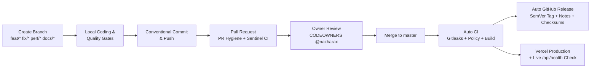

# TallyNX Web

> **Public Portal, Interactive Risk Sandbox, SEO/SSR Shell & Desk Handoff Gateway for Prop-Firm Traders**  
> *Non-Custodial · Pure SaaS Analytics · Open-Source Governance*

[](https://github.com/nakharax/tallynx-web/actions/workflows/deploy-vercel.yml)
[](https://github.com/nakharax/tallynx-web/actions/workflows/pr-hygiene.yml)
[](https://github.com/nakharax/tallynx-web/actions/workflows/release.yml)
[](LICENSE)

> **หมายเหตุภาษาไทย (Thai Quick Navigation):**  
> TallyNX Web คือหน้าเว็บพอร์ทัลสาธารณะ, Risk Sandbox และระบบ SSR/SEO ของแพลตฟอร์ม **TallyNX** (ซอฟต์แวร์วิเคราะห์ความเสี่ยงและทบทวนพฤติกรรมการเทรดแบบ **Non-Custodial** — ไม่รับฝากเงิน ไม่ส่งคำสั่งซื้อขายอัตโนมัติ และไม่ให้คำแนะนำการลงทุน) หากต้องการร่วมพัฒนา ดูขั้นตอนการสร้าง Branch, Commit และเปิด PR ได้ที่ [CONTRIBUTING.md](CONTRIBUTING.md) หรือแจ้งช่องโหว่ความปลอดภัยที่ [SECURITY.md](SECURITY.md)

---

## Core Capabilities

| Module | Description |
| :--- | :--- |
| **Interactive Risk Sandbox** | Instant browser-based position sizing, drawdown buffer visualization, and prop-firm rule simulation with seamless handoff to TallyNX Desk (`desk.tallynx.com`). |
| **SSR / SEO Edge Shell** | Express + Vercel serverless SSR shell (`api/index.ts` + `api/ssr-shell.html`) serving localized metadata, `robots.txt`, `sitemap.xml`, and immutable static asset caching. |
| **AI Behavioral Advisor (Optional)** | Safe-harbor-guarded Gemini advisory helper that strictly declines trade signals and focuses on risk discipline and rule awareness. |
| **Bilingual EN / TH UX** | Full English and Thai experience with high-contrast Paper & Obsidian themes and responsive layouts. |

---

## Architecture Overview

```text
┌─────────────────────────────────────────────────────────────────────────┐
│                             TallyNX Web                                 │
├──────────────────────────────┬──────────────────────────────────────────┤
│  Frontend (SPA + SSR Shell)  │  Backend & Edge Runtime                  │
│  • React 19 + TypeScript     │  • Express / tsx local dev server        │
│  • Vite 8 + Tailwind CSS 4   │  • Vercel serverless SSR (`api/index.ts`)│
│  • Recharts + Motion         │  • Immutable asset & security headers    │
│  • Stateless Desk Handoff    │  • Optional Gemini AI behavioral helper  │
└──────────────────────────────┴──────────────────────────────────────────┘
```

---

## Quickstart

### Prerequisites
- **Node.js** `22.x` (LTS) and **npm** `10+`

### 1. Clone & Install

```bash
git clone https://github.com/nakharax/tallynx-web.git
cd tallynx-web
npm ci
```

### 2. Configure Environment

Copy the example environment file and populate only the variables you need for local development:

```bash
cp .env.example .env.local
```

> Never commit `.env.local` or real API keys. All pull requests are scanned automatically by Gitleaks.

### 3. Run Locally

```bash
npm run dev
```

### 4. Run Local Verification Gates

Before opening a pull request, run the exact same gates enforced by Sentinel CI:

```bash
# 1. Static TypeScript verification
npm run lint

# 2. Deterministic unit tests
npm test

# 3. Legal Safe Harbor & Brand Hygiene policy guard
node scripts/ci-policy-guard.mjs

# 4. Production Vite + SSR shell build
npm run build
```

---

## Open-Source Contribution & Release Lifecycle

All changes follow a strict, deterministic delivery pipeline from feature branch to production:

```text
Create Branch ──► Code & Test ──► Conventional Commit ──► Push & Open PR
                                                               │
                                                               ▼
Production Update ◄── Auto GitHub Release ◄── Auto CI ◄── Owner Review & Merge
```



### CI Security & Fork PR Safety
- **External Fork PRs** run `pr-hygiene`, `secret-scan` (Gitleaks SHA-256 verified), `policy-audit`, `verify-and-build`, and `sentinel-ci` with strictly `contents: read` permissions and **zero access to deployment secrets**.
- **Preview Deployments** run only on trusted non-fork PRs after `sentinel-ci` passes (and skip `dependabot/*` branches cleanly).
- **Production Deployments & Releases** trigger exclusively on `master` after all fail-closed CI gates succeed.

---

## Project Governance & Docs

- [CONTRIBUTING.md](CONTRIBUTING.md) — Branching, Conventional Commits, local gates, and PR workflow
- [SECURITY.md](SECURITY.md) — Non-custodial threat model and responsible vulnerability disclosure
- [CODE_OF_CONDUCT.md](CODE_OF_CONDUCT.md) — Contributor Covenant v2.1
- [CHANGELOG.md](CHANGELOG.md) — Version history and release milestones
- [LICENSE](LICENSE) — MIT License

---

## Legal Safe Harbor Notice

TallyNX Web is strictly an **analytical, educational, and behavioral risk management software portal** (Pure SaaS).

- **Non-Custodial:** TallyNX does not custody funds, access broker passwords, or execute live orders on behalf of users.
- **Not Financial Advice:** Nothing in this repository, UI, documentation, or AI output constitutes financial advice, investment recommendations, or buy/sell trade signals.
- **User Responsibility:** Traders retain 100% control over and responsibility for all trading decisions, position sizing, and compliance with third-party prop-firm rules. No analytical tool can assure trading outcomes or evaluation results.
